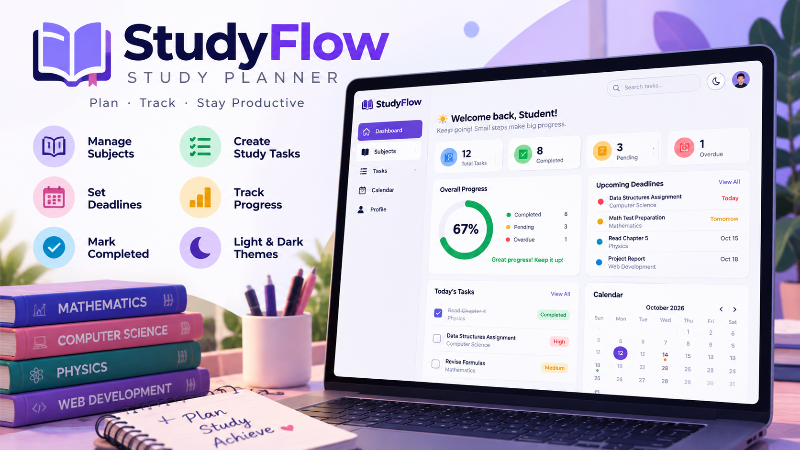

<div align="center">



# StudyFlow — Study Planner

### Plan your learning. Track your progress. Make every study session count.

A responsive student productivity application for organizing subjects, managing study tasks, setting deadlines, and tracking progress — built with **PHP, MySQL, HTML, CSS, and JavaScript**.

<p>
  
  
  
  
  
</p>

<p>
  
  
  
  
</p>

[Features](#-features) · [Application Pages](#-application-pages) · [Tech Stack](#-tech-stack) · [Installation](#-getting-started) · [Database](#-database-design) · [Project Structure](#-project-structure) · [Security](#-security-notes)

</div>

---

## ✨ About the Project

**StudyFlow** is a study planning web application that helps students turn scattered study intentions into a clear, manageable plan. Users can create subjects, add tasks, set due dates and priorities, mark work as complete, and monitor their overall progress from a central dashboard.

The interface uses a calm indigo-and-violet visual identity, responsive layouts, accessible controls, and dedicated light and dark themes. The application is implemented with a straightforward PHP/MySQL backend so it can be studied, extended, and run locally without a frontend framework.

> **Project goal:** Make study planning easier by bringing subjects, tasks, deadlines, and progress into one place.

## 🚀 Features

| Feature | Details |
|---|---|
| 🔐 Account authentication | Register, sign in, and sign out with password hashing and session handling |
| 📊 Progress dashboard | Total, completed, pending, due-today, and overdue task summaries |
| 📚 Subject management | Create, edit, and delete subjects with descriptions and custom colors |
| ✅ Study task management | Add, edit, complete, reopen, and delete tasks |
| 🗓️ Deadlines | Optional due dates with overdue indicators and upcoming deadline lists |
| 🎯 Priority levels | Low, medium, and high priority labels |
| 📈 Progress tracking | Completion percentage and animated progress indicators |
| 🔎 Search and filters | Search tasks and filter by completion status |
| 🗓️ Monthly calendar | Browse months and see tasks on their due dates |
| 🌗 Light and dark themes | Separate palettes, visible theme labels, and `localStorage` persistence |
| 📱 Responsive UI | Desktop, tablet, and mobile-friendly navigation and layouts |
| ♿ Accessibility details | Keyboard focus indicators, semantic labels, and reduced-motion support |
| 🛡️ Safer database access | PDO prepared statements, CSRF tokens, escaped output, and user-scoped queries |

## 🖥️ Application Pages

| Page | Purpose |
|---|---|
| `register.php` | Create a StudyFlow account |
| `login.php` | Sign in to an existing account |
| `dashboard.php` | View study stats, progress, next tasks, and upcoming deadlines |
| `subjects.php` | Browse and manage subjects |
| `subject_form.php` | Add or edit a subject |
| `tasks.php` | Browse, search, filter, complete, and delete tasks |
| `add_task.php` | Add or edit a study task |
| `calendar.php` | View a monthly deadline calendar |
| `logout.php` | End the current session |

## 🧰 Tech Stack

| Technology | Role |
|---|---|
| **PHP 8.1+** | Server-side logic, authentication, form handling, and CRUD operations |
| **MySQL 8.0+ / compatible MariaDB** | Persistent storage for users, subjects, and tasks |
| **HTML5** | Semantic page structure |
| **CSS3** | Responsive layouts, theme variables, component styling, and transitions |
| **Vanilla JavaScript** | Theme switching, mobile navigation, search/filter interactions, and UI feedback |
| **PDO** | Prepared SQL statements and database connectivity |
| **Apache / XAMPP** | Convenient local development environment |

No frontend framework or JavaScript package manager is required.

## ⚙️ Getting Started

### Prerequisites

- PHP **8.1 or newer** (PHP 8.2+ recommended)
- MySQL 8.0+ or a compatible MariaDB server
- Apache, XAMPP, or another PHP-capable web server
- PHP extensions: `pdo_mysql` and `mbstring`
- A modern browser

### 1. Clone the repository

```bash
git clone https://github.com/vishal-git-dot/studyflow-study-planner.git
cd studyflow-study-planner
```

Alternatively, download the repository as a ZIP and extract it.

### 2. Place the project in your web root

For a standard Windows XAMPP installation, place the folder at:

```text
C:\xampp\htdocs\StudyFlow
```

Start **Apache** from the XAMPP Control Panel.

### 3. Create the database

Import [`database/schema.sql`](database/schema.sql) using phpMyAdmin or the MySQL command line.

```bash
mysql -u root -p < database/schema.sql
```

If the local MySQL root account has no password, omit `-p`. For a non-default port, add an option such as `-P 3307`.

The SQL file creates the `studyflow` database and its required tables.

### 4. Configure the database connection

Open `config/config.php` and update these values to match the MySQL server you intend to use:

```php
define('DB_HOST', '127.0.0.1');
define('DB_PORT', '3306');
define('DB_NAME', 'studyflow');
define('DB_USER', 'root');
define('DB_PASS', '');
```

**Important:** XAMPP MySQL and a separately installed Windows `MySQL80` service may use different ports. Check which server you are using before changing the port. Do not run two MySQL servers on the same port.

The default credentials above are for local development only. Use a dedicated database user and a strong password for any shared or deployed environment.

### 5. Open StudyFlow

For XAMPP, visit:

```text
http://localhost/StudyFlow/public/
```

Create an account, add your subjects, and start planning study tasks.

### Alternative: PHP built-in server

From the project root, run:

```bash
php -S 127.0.0.1:8000 -t public
```

Then open `http://127.0.0.1:8000/`. Make sure the database is running and configured first.

## 🗄️ Database Design

StudyFlow uses three main tables.

### `users`

| Column | Type | Purpose |
|---|---|---|
| `id` | BIGINT, primary key | Unique user identifier |
| `name` | VARCHAR(80) | User's display name |
| `email` | VARCHAR(190), unique | Login email |
| `password_hash` | VARCHAR(255) | Securely hashed password |
| `created_at` | TIMESTAMP | Account creation time |

### `subjects`

| Column | Type | Purpose |
|---|---|---|
| `id` | BIGINT, primary key | Unique subject identifier |
| `user_id` | BIGINT, foreign key | Owner of the subject |
| `name` | VARCHAR(100) | Subject name |
| `description` | VARCHAR(500) | Optional subject notes |
| `color` | CHAR(7) | Hex color used in the UI |
| `created_at`, `updated_at` | TIMESTAMP | Record timestamps |

### `study_tasks`

| Column | Type | Purpose |
|---|---|---|
| `id` | BIGINT, primary key | Unique task identifier |
| `user_id` | BIGINT, foreign key | Owner of the task |
| `subject_id` | BIGINT, nullable foreign key | Associated subject, if any |
| `title` | VARCHAR(180) | Task title |
| `description` | TEXT | Optional task notes |
| `due_date` | DATE, nullable | Task deadline |
| `priority` | ENUM | `low`, `medium`, or `high` |
| `status` | ENUM | `pending` or `completed` |
| `completed_at` | DATETIME, nullable | Time the task was completed |
| `created_at`, `updated_at` | TIMESTAMP | Record timestamps |

### Relationships

```text
users 1 ─────────── * subjects
users 1 ─────────── * study_tasks
subjects 1 ──────── * study_tasks
```

Each subject and task belongs to a user. A task can optionally be associated with a subject. Deleting a subject leaves its tasks in place and sets their `subject_id` to `NULL`; deleting a user removes their associated records.

## 📁 Project Structure

```text
StudyFlow/
├── config/
│   ├── config.php
│   └── database.php
├── database/
│   └── schema.sql
├── docs/
│   └── images/
│       └── studyflow-banner.png
├── includes/
│   ├── auth.php
│   ├── functions.php
│   ├── header.php
│   └── footer.php
├── public/
│   ├── assets/
│   │   ├── css/app.css
│   │   └── js/app.js
│   ├── index.php
│   ├── login.php
│   ├── register.php
│   ├── logout.php
│   ├── dashboard.php
│   ├── subjects.php
│   ├── subject_form.php
│   ├── subject_action.php
│   ├── tasks.php
│   ├── add_task.php
│   ├── task_action.php
│   └── calendar.php
├── .htaccess
├── LICENSE.txt
└── README.md
```

## 🎨 UI and Design Details

- **Visual identity:** Indigo and violet accents with calm neutral surfaces.
- **Light mode:** Bright backgrounds, crisp cards, and muted supporting text.
- **Dark mode:** Deep navy surfaces, readable text, and theme-appropriate accent colors.
- **Responsive layout:** Collapsible mobile sidebar, adaptive grids, and horizontally scrollable task tables.
- **Interaction feedback:** Button hover and press states, animated progress bars, dismissible toast messages, form validation, and delete confirmations.
- **Motion accessibility:** Reduced animation when `prefers-reduced-motion` is enabled.
- **Theme persistence:** The selected theme is stored in browser `localStorage`.

## 🔒 Security Notes

This repository is a **starter project for learning and development**, not a security-audited production system.

Implemented safeguards include:

- Password hashing using PHP's `password_hash()` and verification using `password_verify()`.
- PDO prepared statements for database operations.
- CSRF token checks on state-changing form submissions.
- Escaped user-generated text when rendered in HTML.
- Session ID regeneration after successful authentication.
- User-scoped database queries to prevent users from accessing another user's tasks or subjects through normal application routes.
- Confirmation prompts for destructive actions.

Before deploying publicly, configure HTTPS, secure session cookie attributes, a dedicated database account with least-privilege permissions, login rate limiting, password reset and email verification, security headers, backups, and server-side error logging. Configure the web server document root to `public/` so private application folders cannot be served directly.

## 🧭 Current Scope and Possible Improvements

The current starter focuses on subjects, tasks, deadlines, priorities, completion status, a progress dashboard, and a monthly calendar.

Possible next improvements:

- Weekly and daily calendar views
- Study sessions and a Pomodoro timer
- Task reminders and email notifications
- Recurring tasks
- Subject-specific analytics and study streaks
- Export tasks to CSV
- Password reset and email verification
- Automated PHP tests and deployment configuration

## 🤝 Contributing

1. Fork the repository.
2. Create a feature branch: `git checkout -b feature/your-feature`.
3. Make your changes and test the affected workflows.
4. Commit your work: `git commit -m "Add your feature"`.
5. Push your branch and open a pull request.

## 📄 License

This project includes a learning-friendly license notice in [`LICENSE.txt`](LICENSE.txt). Review that file before redistributing the project or using it in a commercial product.

---

<div align="center">

**StudyFlow** — *Small steps add up.*

Made to help students plan with clarity, focus with purpose, and celebrate progress.

</div>
